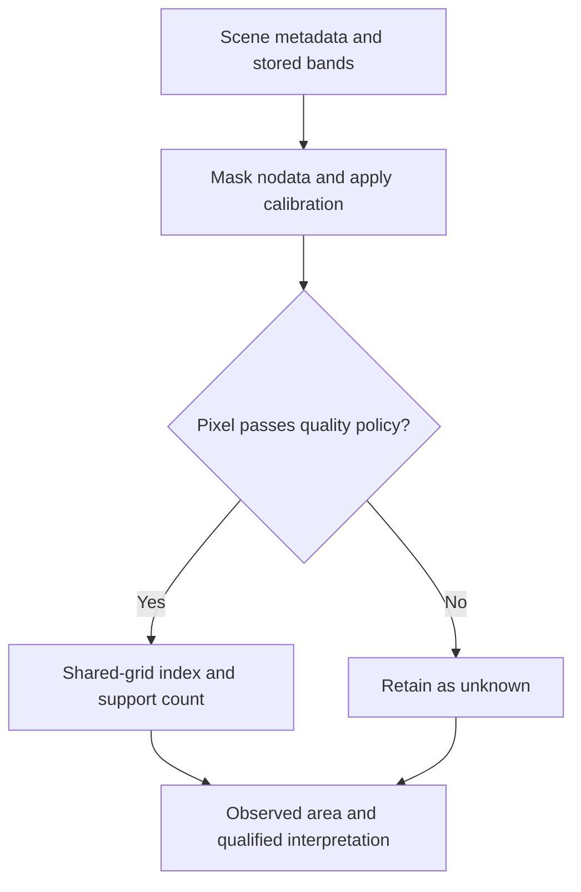

# Week 1. From light to a defensible measurement

**Prepared by Adrian Dunkley, Physicist, Climate Studies Group, Mona.**

## Learning outcomes and preparation

By the end of this class, you should be able to explain what an index measures, apply an asset's calibration, identify missing pixels, and state the spatial support of an area estimate. Reopen original notebooks 01 and 02 before class. Bring one question about vegetation or open water near a Jamaican community, but avoid collecting household locations or personal information.

The central question is precise: how much of a chosen study rectangle has a vegetation-like spectral response among pixels that can actually be observed? This question leaves room for missing data. A cloud-covered pixel has no reliable surface observation in that acquisition; assigning it zero would change an absence of information into a claim about the ground.

## Explain the measurement before writing the code

A satellite detector records electromagnetic energy in wavelength bands. A processed surface-reflectance product estimates how the surface reflects incoming light after atmospheric correction. An image brightness value and surface reflectance are different quantities. The Sentinel-2 product documentation describes its processing levels and calibration [S1]. An NDVI calculation must use comparable red and near-infrared reflectance values.

The normalized difference vegetation index is

$$
\mathrm{NDVI}=\frac{\rho_{NIR}-\rho_{red}}{\rho_{NIR}+\rho_{red}}.
$$

Here \(\rho\) denotes dimensionless reflectance. If the red reflectance is 0.10 and the near-infrared reflectance is 0.50, NDVI is 0.40/0.60, approximately 0.667. These are invented teaching values. If both inputs are zero, the index is undefined and the code should retain a missing value. A convenient tiny denominator must not disguise an unobserved pixel as a measured index.

Think of the sensor as a science-fiction ship's instrument panel. The panel reports a signal through a particular instrument. It cannot independently tell you whether people may enter a park or what a farmer lost. Those questions require other evidence. The analogy helps separate the observation from the story you want to tell about it.

## Calibration and quality decisions

A stored digital number may require a scale and offset:

$$
\rho=sD+o.
$$

Use the metadata for the exact asset being read. With an illustrative stored value of 2,000, scale 0.0001 and offset -0.1, reflectance is 0.1. Blindly dividing by 10,000 would return 0.2. Applying the offset twice would also be wrong. Some providers harmonize values, so source-product calibration must not be reapplied to an already calibrated output. The Earth Search catalogue exposes raster metadata; inspect the selected item rather than assuming every asset follows one rule [S1, S2].

Scene-level cloud percentage describes a tile. The school or community may occupy a cloudy corner of an otherwise clear tile. The course therefore uses pixel-level scene classification and a conservative accepted-class policy. For this exercise accept vegetation, non-vegetated surfaces and water; reject other classes. This is a teaching policy, not proof that every accepted pixel is clear. The Scene Classification Layer is a categorical raster. Preserve labels when aligning it to another grid; the Rasterio documentation explains resampling choices [S3].

A composite combines observations from several dates. Its median may reduce some unwanted variation, but it does not guarantee a cloud-free view. Save a support-count map next to the composite: how many valid observations contributed at each pixel? Compare the resulting map when you require one, two and four valid observations. If coverage falls when the rule tightens, report that change.

## Area, resolution and denominator

On the course's projected square grid, one 20 m by 20 m pixel represents 400 square metres, or 0.04 hectares. Thus 250 selected pixels represent 10 projected hectares. These values follow from the chosen grid spacing, not a measurement of a particular community. Projected area has projection distortion; an exact cadastral survey requires appropriate survey methods. Regridding a coarser band onto 10 m cells does not add independent 10 m information.

Report the selected area, the jointly observed area and the area that could not be evaluated. Define a percentage as selected area divided by observed eligible area. The whole rectangle is an unsuitable denominator if a large share is missing. In a coastline study, water and land masks also affect which area is eligible. Keep that choice consistent across dates.

## Class activity and teaching prompts

Work through notebook 05. Compare an unmasked index with a cloud-masked composite, then draw the support count. Change the minimum observation rule and describe which parts of the map disappear. Use the optional live section only after the synthetic example is clear; save the selected scene's metadata with the image.

At minute 45 ask: which error changes the measurement, and which changes only its interpretation? At the evidence discussion ask a partner to reproduce your denominator from your data card. If they cannot, revise the card. Your homework is a map with a caption that names the input, dates, units, quality rule and unknown area, together with a short paragraph explaining what the index cannot establish.

Read [S1–S3 in the source list](../SOURCES.md). No numerical outcome in this lecture is a measured result from Jamaica.

## Measurement workflow

This diagram describes the measurement procedure, not a validated outcome.
