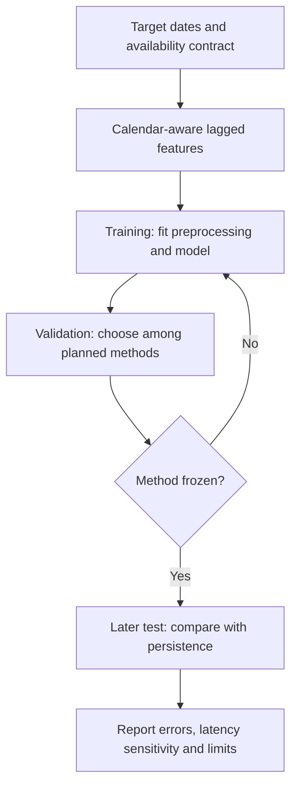

# Week 3. Forecasting without future information

**Prepared by Adrian Dunkley, Physicist, Climate Studies Group, Mona.**

## Learning outcomes and forecast contract

This week you will construct lagged predictors, separate training from later evaluation, compare a simple model with persistence and test a data-availability assumption. Revisit original notebook 04. A trend fitted to historical temperatures describes that series under its assumptions. It does not alone demonstrate tomorrow's forecast skill.

Write a forecast contract before fitting: target variable, units, forecast issue time, lead time, geographic support and information available at issue time. The laboratory predicts a daily mean temperature using previously available values and known calendar features. The default series is invented. It is intended to reveal leakage and baseline behaviour, not to measure Jamaican forecasting performance.

## Dates and publication time are different

A value labelled Tuesday may become available on Wednesday or later. A model issued on Tuesday morning cannot use it merely because a downloaded table places it in Tuesday's row. Keep the observation time and availability time separate. NASA POWER documents its products and latency; inspect those details before describing a retrospective reconstruction as an operational forecast [S4, S5].

For a target at day \(t\), the first experiment uses values only through \(t-1\). A rolling seven-day mean must therefore be computed from the shifted series. If the rolling mean includes \(y_t\), the target has leaked into its predictors. If a required product has a seven-day delay, rebuild the features using values through \(t-7\) and compare. The delay experiment does not prove that the live product has a seven-day latency; it shows how sensitive the method is to a stated assumption.

Missing dates need attention before shifting rows. Removing a day and then shifting one row does not necessarily create a one-day lag. Reindex a complete daily calendar, preserve missing values and construct time-based features. Any imputation method must use only information that was available at the forecast issue time. The provided helper rejects an irregular calendar so this problem cannot pass silently.

## Split in the direction of use

Training data estimate model parameters. Validation data guide any planned model choices. A final later test period evaluates the chosen method. Keep these roles separate. A random split can place future observations in the training set for a past prediction. When comparing across storms, stations or communities, additional event or spatial holdouts may be needed.

The scikit-learn TimeSeriesSplit interface provides ordered splits and a gap option [S6]. In the exercise you will inspect the training and validation boundary of each fold, then use a fixed chronological split for the main comparison. A gap is helpful only when it matches the information problem; it is not a universal cure for leakage. Fit scalers and any learned preprocessing inside the training portion.

The provided Ridge model has a fixed penalty chosen for the teaching example. It uses a pipeline that fits scaling on training only. Students may propose alternative penalties, but must choose them through the validation procedure and leave the final test untouched until that choice is frozen. Record any earlier inspection of the test results.

## A baseline makes skill interpretable

Persistence predicts the latest available temperature. It can be competitive when adjacent days resemble one another. Compare the model and persistence on the same target dates. The baseline's availability lag must match the model's; giving the model delayed data and the baseline a fresh observation answers a different question.

For errors \(e_i=\hat y_i-y_i\), use

$$
\mathrm{MAE}=n^{-1}\sum_i |e_i|,\qquad
\mathrm{RMSE}=\sqrt{n^{-1}\sum_i e_i^2}.
$$

Both are in degrees Celsius when the target is temperature. RMSE places greater weight on large errors. Neither score establishes good performance on extremes unless you evaluate those cases explicitly. Plot predictions against the target and plot errors in time; an acceptable overall average may conceal a problematic season.

## What the live product represents

NASA POWER supplies gridded environmental products with parameter-specific source data, time aggregation and units. It is not a thermometer installed at the selected coordinate. Solar and meteorological variables need not share the same underlying grid or historical availability [S4, S5]. Retain metadata when requesting T2M, T2M_MAX, precipitation or surface radiation. Two nearby sites can share a grid value, and an interpolated picture does not create independent neighbourhood observations.

## Class activity and assignment

Run notebook 07, inspect the ordered folds and compare fixed Ridge with persistence. Repeat with availability lags of one and seven days. Record both periods even if the model loses. Then write a short critique of a fictional claim that a low random-split error proves preparedness for the next hurricane. Explain the target, lead time and event mismatch.

Your submission contains the forecast contract, split dates, two baseline/model tables and one residual chart. For an observed-data project, also save the raw response and units. The test measures skill against the chosen product; independent station evaluation is a separate requirement. Read [S4–S6](../SOURCES.md).

## Information and evaluation boundaries

Inspecting test outcomes repeatedly can turn them into development data.
