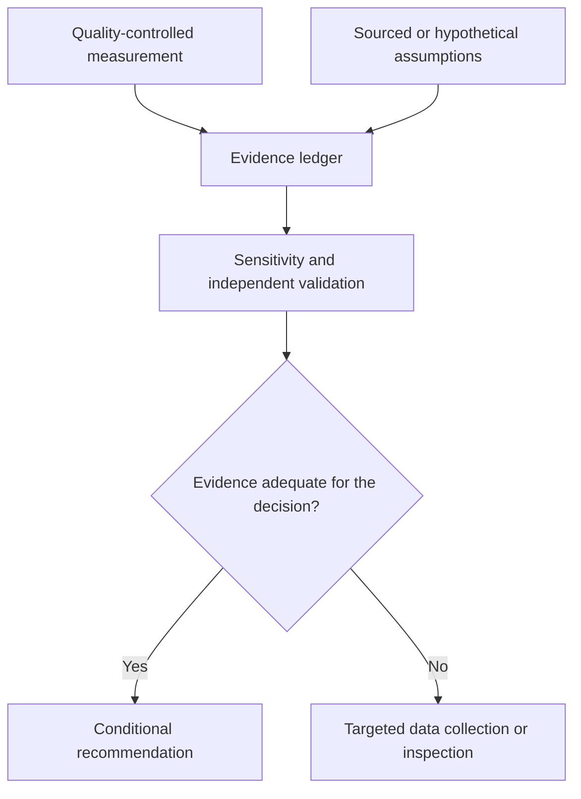

# Week 4. From a map to a public decision

**Prepared by Adrian Dunkley, Physicist, Climate Studies Group, Mona.**

## Learning outcomes and capstone scope

This week you will assemble a reproducible analysis, distinguish evidence from assumptions and present a decision with clear conditions. Select one of the original challenges: candidate vegetation change and a loss scenario, solar-site comparison, or vegetation per resident. An optional fourth track evaluates a weather-product forecast. Continue your own community question if the instructor agrees that the data can answer it.

The outcome is an evidence package another student can run. It contains a question, documented inputs, method, outputs, interpretation and limitations. It is not a production disaster warning, a land valuation or an accredited planning assessment. The course gives you a way to organize a defensible investigation before those decisions require specialist review.

## Separate the measurement from its meaning

Make an evidence ledger with four columns: statement, evidence type, source or file, and limitation. A saved NDVI map is an analysis output. A chosen crop price is an assumption unless linked to applicable data. A published product specification is external documentation. A recommendation is your interpretation. Keeping these distinct makes disagreements easier to resolve.

For vegetation per resident, define the population boundary and date. Vegetation-like pixels can include private gardens, farms and inaccessible land. Their area divided by population does not establish access to public green space or compliance with a health-planning standard. Use any benchmark only after locating its original definition and checking whether your indicator matches it. Avoid repeating an unsourced universal minimum.

For solar siting, sunlight is one input. Land rights, slope, protected areas, grid connection, flooding and demand may change a choice. A rough energy scenario can multiply incident daily energy per square metre by panel area, efficiency and a performance ratio. Keep the source units consistent. Multiplying a daily mean by a fixed 30 days is a teaching approximation; an annual scenario should weight by actual calendar days and disclose losses. The NASA POWER product documentation explains where to inspect units and source support [S4, S5].

## Scenarios and the cost of a wrong decision

Notebook 08 demonstrates a deliberately synthetic production-loss scenario. Its structure is

$$
L=A f v d,
$$

where \(A\) is candidate hectares, \(f\) is the assumed farmland share, \(v\) is annual production value in JMD per hectare and \(d\) is the assumed recovery duration in years. The unit is JMD. This simple multiplication ignores discounting, changes in output during recovery and double counting between asset and income losses. State those omissions if you use it.

A low-to-high scenario range is not automatically a probability interval. Its meaning comes from the inputs chosen. A narrow range produced by narrow assumptions can still miss the true outcome. Change one input at a time, then discuss plausible joint changes. Ask what field observation would most reduce the decision uncertainty.

Consider a relief team that can inspect only two locations. The largest candidate-change area may justify attention, while the location with the poorest observation coverage may justify a different kind of inspection. Distinguish an inspection priority from an allocation decision. The class should be able to explain why a changed threshold or missing reference label could alter the recommendation.

## Reproducibility is part of the result

Save source identifiers, retrieval dates, study boundary, coordinate system, calibration, mask, thresholds, split dates and random seeds. Keep the raw service response when permitted. For small derived outputs, save checksums so later runs can be compared with an exact file. A checksum verifies byte identity; it does not verify scientific correctness.

Use the provided manifest writer and include the environment lock file. Run the notebook in a fresh kernel from the first cell. Confirm that no variable depends on a previous interactive session. Avoid absolute paths to your laptop. Do not silently download a substitute dataset when a request fails. If an external service is unavailable, preserve the failure and label any synthetic demonstration separately.

A result file should state whether its inputs are synthetic, observed or mixed. The default capstone stays synthetic, even though the bounding-box examples elsewhere use Jamaican place names. Once you replace inputs with observations, update every caption and the manifest. An observed measurement combined with hypothetical prices is a mixed analysis, and its interpretation must say so.

## Presentation, peer review and marking

Prepare a five-minute presentation with the question, one main chart, the method, the largest uncertainty and a conditional recommendation. Put units and dates where the audience can see them. Ask a partner to identify the denominator in your main percentage and locate the source for your most consequential numerical assumption.

The peer reviewer should attempt one failure case: an empty input, missing coverage, a reversed date window or a failed service. The analysis should either handle the case transparently or stop with a useful error. A failure exposed during review is an opportunity to strengthen the work, not a reason to hide the test.

Submit the notebook, small permitted outputs, manifest, data card and report. The assessment rubric rewards valid reasoning, reproducibility and honest limits. It gives no extra credit for a particular policy conclusion or for claiming the model beats a baseline. Cite the [source register](../SOURCES.md) alongside any additional sources you actually used.

## Evidence ledger and decision

The appropriate decision can be to obtain better evidence.
